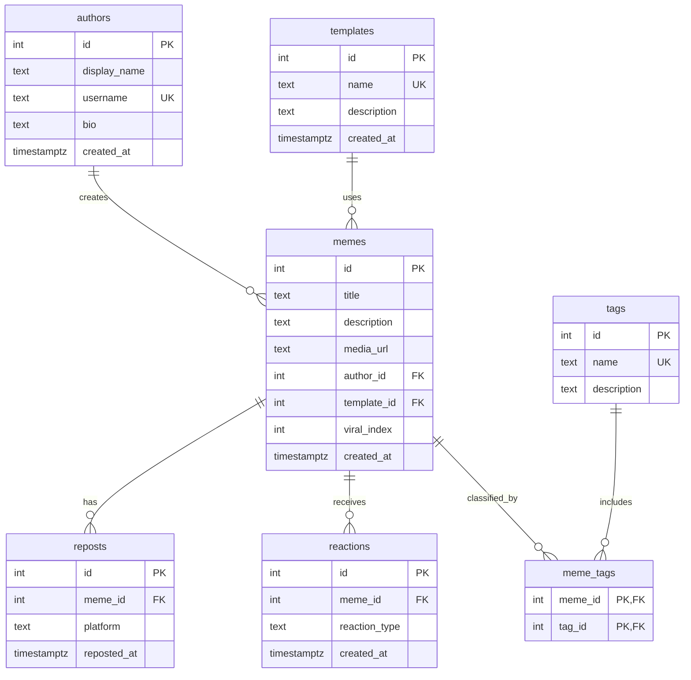

# Реестр мемов

Тема №25: **Реестр мемов**. База данных хранит мемы, их авторов и шаблоны, а также теги, репосты и реакции. Эти данные нужны для каталогизации мемов и анализа их распространения.

| Пункт | Описание |
| --- | --- |
| Главная таблица | `memes` — мемы |
| Связь N:M | Мемы и теги через `meme_tags` |
| Бизнес-правило | Индекс вирусности мема автоматически пересчитывается на основе репостов и реакций. Реализация запланирована на лабораторную №3. |
| СУБД | PostgreSQL 17 в Docker |

## Состав базы данных

- `authors` — авторы мемов.
- `templates` — шаблоны мемов.
- `memes` — мемы, их описания и ссылки на изображения.
- `tags` — теги для классификации мемов.
- `meme_tags` — связующая таблица мемов и тегов.
- `reposts` — репосты мемов на различных платформах.
- `reactions` — реакции на мемы.

В текущей версии репосты и реакции не привязаны к отдельным зарегистрированным пользователям.

## Задания курса

Правила курса, установка и порядок сдачи: [docs/README.md](docs/README.md).

| Лаба | Задание |
| --- | --- |
| 1. Модель данных и схема | [docs/lab-1.md](docs/lab-1.md) |
| 2. Запросы | [docs/lab-2.md](docs/lab-2.md) |
| 3. Логика в базе | [docs/lab-3.md](docs/lab-3.md) |
| 4. Транзакции и доступ | [docs/lab-4.md](docs/lab-4.md) |
| 5. Производительность | [docs/lab-5.md](docs/lab-5.md) |
| Витрина к защите | [docs/showcase.md](docs/showcase.md) |

## Как запустить

В PowerShell из папки проекта:

```powershell
Copy-Item .env.example .env  # если .env ещё не создан
docker compose up -d
```

При первом запуске скрипты из папки `db/` выполняются автоматически.

Проверка лабораторной №1:

```powershell
dbcheck --lab 1
dbcheck --lab 1 --fresh
```

Подключение к базе:

```powershell
docker compose exec db psql -U postgres -d app
```

Сценарий лабораторной можно запустить внутри `psql`:

```sql
\i /demo/lab1.sql
```

Если локальный порт 5432 занят другой программой, в `.env` можно указать свободный порт, например `DB_PORT=5433`.

**Внимание:** команда `docker compose down -v` удаляет Docker-том вместе со всеми данными PostgreSQL. Используйте её только тогда, когда готовы удалить данные и создать базу заново.

## ER-диаграмма



Таблица `meme_tags` реализует связь N:M: один мем может иметь несколько тегов, а один тег может относиться к нескольким мемам. Составной первичный ключ `(meme_id, tag_id)` не допускает повторения одной пары.

## Ограничения целостности

| Ограничение | Таблица и колонки | Назначение |
| --- | --- | --- |
| `PRIMARY KEY` | Все таблицы | Уникальная идентификация строк |
| `FOREIGN KEY` | Все колонки со ссылками | Защита от ссылок на несуществующие записи |
| `UNIQUE` | `authors.username` | Уникальные имена пользователей |
| `UNIQUE` | `templates.name`, `tags.name` | Уникальные названия шаблонов и тегов |
| `CHECK` | `memes.viral_index >= 0` | Индекс вирусности не может быть отрицательным |
| `CHECK` | `memes.title` | Название не может быть пустым или состоять только из пробелов |
| `CHECK` | `reposts.platform`, `reactions.reaction_type` | Разрешены только заданные значения |
| `NOT NULL` | Обязательные поля таблиц | Запрет отсутствующих обязательных значений |


## Лабораторная №2. Запросы к данным

В файле `demo/lab2.sql` подготовлено 15 пронумерованных запросов.

Обязательная часть (12 запросов):
- Соединение таблиц с помощью `JOIN`.
- Группировка и агрегаты `GROUP BY`, `COUNT`, `HAVING`.
- Поиск неиспользуемых тегов через `LEFT JOIN` и `IS NULL`.
- Подзапросы `IN`, `EXISTS` и скалярные подзапросы.
- Демонстрация `INSERT`, `UPDATE`, `DELETE` с проверкой результата до и после изменения и откатом через `ROLLBACK`.

Дополнительная часть (3 запроса):
- CTE (`WITH`) и `ROW_NUMBER()` для поиска топ-3 мемов в каждой категории.
- Оконная функция `LAG()` для анализа последовательности репостов.
- Сводная статистика с условными подсчётами через `FILTER` и расчётом процентов.

Проверка:

```powershell
dbcheck --lab 2 --stars
dbcheck run demo/lab2.sql --sql


## Что сделано по лабораторным

| Лаба | Что сделано | Сценарий |
| --- | --- | --- |
| 1 | Созданы 7 таблиц, первичные и внешние ключи, ограничения; добавлены тестовые данные и проверки ошибок. | `demo/lab1.sql` |
| 2 | Добавлены 15 SQL-запросов: JOIN, GROUP BY, HAVING, LEFT JOIN, подзапросы, INSERT, UPDATE, DELETE, CTE, оконные функции и условные подсчёты. | `demo/lab2.sql` || 3 | Предстоит реализовать представления, функции и триггеры, включая автоматический пересчёт индекса вирусности. | `demo/lab3.sql` |
| 4 | Предстоит выполнить задания по транзакциям, доступу и конкурентным операциям. | `demo/lab4.sql`, `demo/race.sql`, `demo/race_fixed.sql` |
| 5 | Предстоит проверить производительность запросов и индексов. | `demo/lab5.sql` |